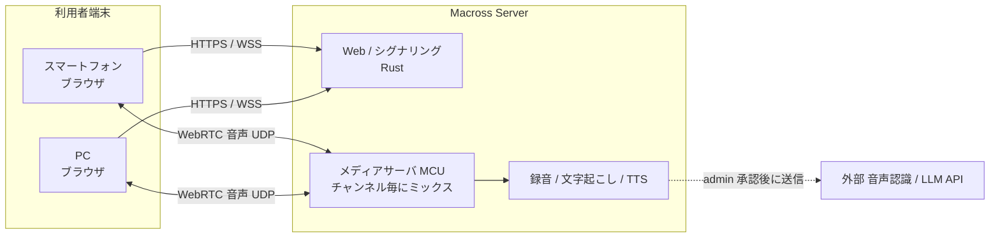

# Macross要件定義書

> ステータス: ドラフト v0.4（2026-11-11 未決事項の回答を反映）
> 「（案）」と付いた記述は提案段階で、作者の確定事項ではない。未決事項は [11. 要確認事項](#11-要確認事項) を参照。

## 1. 概要

### 1.1 正式名称
Made in Aketimaika Communication Radio with On-demand Speech Services（略称: Macross）

### 1.2 目的・利用場面
- 無線を必要としているが、チャンネル不足／資金不足により無線機を準備できない場合
- 盗聴が懸念されるが、無線的な連絡手段が必要な場合

### 1.3 基本方針（Mission）
- 可能な限り既存OSSを活用して構築する
- 低遅延・高音質な音声伝送を行う
- 自作部分は Rust（サーバ）／Vue.js（フロントエンド）で作成する
- サーバの設定は `Macross.yaml` で管理する（[7章](#7-設定ファイル-macrossyaml)）
- 利用者はブラウザから URL にアクセスするだけで利用でき、追加アプリのインストールを不要とする

## 2. 用語定義

| 用語 | 意味 |
|---|---|
| チャンネル | 音声を共有する論理グループ。最大9 |
| PTT | Push To Talk。発言ボタン押下中のみ送信・録音する方式 |
| 発言枠 | 同一チャンネルで同時に発言できる人数の上限 |
| LR受聴 | 2チャンネルを同時に受信し、左右のイヤホン／スピーカーに振り分けて聴くこと |
| ID | システムが自動発行する利用者識別子 |
| admin | GUIから設定・権限を操作できる管理者ロール |
| MCU | Multipoint Control Unit。サーバ側で各話者の音声をミックスし、1本の音声として配信する方式 |
| TOTP | 時刻ベースのワンタイムパスワード（RFC 6238）。Google Authenticator が対応 |

## 3. スコープ

### 3.1 対象
- ブラウザ間のリアルタイム音声通話（PTT）
- チャンネル管理（最大9）、LR受聴
- 録音（MP3）、リアルタイム文字起こし、テキスト読み上げ（TTS）
- ユーザ・認証・権限管理、管理GUI
- 監視・可視化

### 3.2 対象外
- 映像の伝送
- ネイティブアプリ（iOS / Android / デスクトップ）
- エンドツーエンド暗号化（サーバでのミックス・録音・文字起こしと両立しないため。[5.3](#53-セキュリティ) 参照）

## 4. 機能要件

### 4.1 音声通話・PTT
- 発言ボタンが押されている間、音声を送信し、同時に録音する（PTT）
- 同時に喋れる人数（発言枠）を管理GUIから設定できる
- 配信方式は **MCU** とする
  - サーバは端末ごとの音声を受信し、チャンネルごとにミックスして、チャンネル受信者全員へ配信する
  - 自分の声が自分に返らないよう、受信者ごとに本人の音声を除いたミックスを配信する（案）

### 4.2 チャンネル・LR受聴
- チャンネルは最大9まで作成できる
- 利用者はチャンネルを選択して相互に通信する
- 2チャンネルを同時に受信し、左右（L/R）に振り分けて聴けるように設定できる
  - 実装（案）: サーバから2チャンネル分のミックスを受け取り、クライアント側で左右に定位する

### 4.3 録音
- 発言ボタンが1回押されるごとに、1つの録音ファイルを作成する
- `Macross.yaml` で指定した保存先に MP3 で保存する
- 録音ごとにタイムスタンプを記録する
  - 形式: `yyyy-mm-dd_HHMM`（例: `2026-11-11_1430`。JST、`HHMM` は録音開始の時分）
  - ファイル名（案）: `<チャンネル>/yyyy-mm-dd_HHMM_<ID>.mp3`
    - 同じ分に同じ人が複数回押した場合は末尾に連番を付ける（例: `_2`）（案）
- 保存先は初期構成で File Browser（OSS）により公開し、ブラウザから閲覧・再生・ダウンロードできるようにする（admin のみ）
- 録音の保持期間は **3ヶ月** とし、期限を過ぎた録音は自動削除する
  - 容量の目安（案）: 64kbps の MP3 で約 29MB/時間。ストレージ 64GB のうち約 40GB を録音に充てると、約 1,400 時間分

### 4.4 リアルタイム文字起こし
- 外部の音声認識 / LLM API と接続し、リアルタイムに文字起こしを行う
- 外部APIへ音声・テキストを送ることは許容する。**ただし送信前に必ず管理GUIから admin の承認を取る**（[5.3](#53-セキュリティ)）
- 使用する外部APIは未定（[11章](#11-要確認事項)）

### 4.5 テキスト読み上げ（TTS）
- テキスト入力を音声に変換してチャンネルに送信する
- 読み上げ音声は ID ごとにユニークな声質とする
- TTS エンジンは **Open JTalk** を使用する
  - Open JTalk の音声モデルは数が限られるため、ID ごとに声の高さ・話速・声質パラメータを変えてユニーク性を出す（案）
- 開発フェーズ2で実装する

### 4.6 ユーザ・認証・権限
- ID はシステムが自動発行し、CSV で管理する
- CSV の項目: ID（自動発行）, 名前, ふりがな, メールアドレス, 初期パスワード
- CSV およびパスワードハッシュはサーバ上に保存する
  - パスワードは平文で保存せず、ハッシュ（案: Argon2）で保持する
  - 初期パスワードは初回ログイン時に変更を求め、変更後は CSV から消す（案）
  - admin 権限・2段階認証の秘密鍵は CSV とは別の場所に保存する（案）
- 個人ごとにパスワードを任意に設定できる
- 任意で2段階認証を有効化できる
  - 方式: TOTP（Google Authenticator に対応）
- ロールは **admin** と一般ユーザの2種類とする
- admin 権限を GUI から付与・剥奪できる

### 4.7 管理GUI（admin のみ操作可）
- 発言枠の設定
- チャンネルの作成・削除
- admin 権限の設定
- ユーザ（ID）の発行・無効化
- 外部APIへの送信の承認

### 4.8 監視・可視化
- 現在の通信量等を可視化する
- 以下のツールに対応する
  - Prometheus（メトリクス）
  - Loki（ログ）
  - Grafana（ダッシュボード）
  - Zabbix（死活・リソース監視）

## 5. 非機能要件

### 5.1 遅延（案）
- 発話から相手の耳に届くまで 300ms 以下を目標とする（MCU のミックス処理時間を含む）

### 5.2 音質（案）
- コーデック: Opus（WebRTC 標準）
- ビットレート・サンプリングレートは `Macross.yaml` の通信品質設定で変更可能とする

### 5.3 セキュリティ
- 通信路は暗号化する（WebRTC: DTLS-SRTP、Web・シグナリング: TLS）
- 録音ファイル・ID管理CSV の保存先アクセス権を制限する
- 外部APIへ音声・テキストを送信する機能は、送信前に必ず管理GUIから admin の承認を取る
  - 承認されるまでは外部へ一切送信しない
  - `Macross.yaml` で機能自体を無効化できるようにする（案）

### 5.4 性能・規模
- サーバは最低要件（[8.2](#82-サーバ)）で構築する
- フェーズ1の最大同時接続数は **30人** とする
- 最終目標は最大接続数 300人（[10章](#10-開発フェーズと受け入れ基準) フェーズ6）
  - MCU はサーバでミックスするため CPU 負荷が大きい。300人を最低要件で賄えるかはフェーズ6で検証する

### 5.5 運用
- 録音の保持期間は3ヶ月とし、期限切れの録音を自動削除する（[4.3](#43-録音)）
- ログは Loki に集約する

## 6. システム構成

### 6.1 構成概要
- コンテナでチャンネル管理を行い、マスターと必要に応じてサブを構築する
  - マスターのみで通信を支えることが難しくなった場合、サブを構築し、マスターはロードバランシングを行う
- この機能が実現できれば、手段（Docker のマスター／サブコンテナ、Kubernetes 等）は問わない

### 6.2 通信経路
- Cloudflare Tunnel は WebRTC の音声（UDP）を中継できないため、**サーバを直接公開** し、音声は端末とサーバ間で直接やり取りする
  - Web 画面・シグナリング用の HTTPS（TCP 443）と、WebRTC 用の UDP ポートを公開する
  - Cloudflare Tunnel の使用は必須としない

## 7. 設定ファイル `Macross.yaml`

| 項目 | 内容 |
|---|---|
| ドメイン | 公開するドメイン。HTTPS 証明書（Caddy）・監視画面の URL もここから自動設定 |
| HTTPS 方式 | Caddy（Let's Encrypt）／Cloudflare Tunnel の切り替え |
| 録音保存先 | サーバ側で自動録音したMP3の保存ディレクトリ |
| 接続上限 | 最大同時接続数（フェーズ1は30） |
| 通信品質 | コーデックのビットレート等 |
| 録音保持期間 | 自動削除までの期間（既定: 3ヶ月） |
| （案）外部API設定 | 文字起こし／LLM API の有効・無効、エンドポイント、キー参照先 |
| （案）公開ポート | HTTPS ポート、WebRTC 用 UDP ポート範囲 |

## 8. 動作環境・使用資源

### 8.1 クライアント
- スマートフォン
  - Chromium 系ブラウザ（Android）
  - Safari（iOS。iOS 上のブラウザは全て WebKit のため、iPhone 対応には Safari 対応が必須）
- PC
  - Chromium 系ブラウザ

### 8.2 サーバ
- Linux サーバ（作者は Rocky Linux 9 でテスト予定）
- 最低要件（この構成で構築する）
  - CPU: 4コア
  - メモリ: 8GB
  - ストレージ: 64GB

### 8.3 公開
- https://Macross.build-maika.jp
  - サーバを直接公開する（Cloudflare Tunnel は任意。[6.2](#62-通信経路) 参照）

## 9. 使用技術・OSS候補
- [Rust](https://rust-lang.org/ja/)
- [Vue.js](https://ja.vuejs.org/)
- [Docker](https://www.docker.com/ja-jp/)
- [WebRTC](https://webrtc.org/)
- 監視: [Zabbix](https://www.zabbix.com/jp) / [Grafana](https://grafana.com/ja/) / [Prometheus](https://prometheus.io/) / [Loki](https://grafana.com/ja/oss/loki/)
- TTS: [Open JTalk](https://open-jtalk.sourceforge.net/)
- 録音ブラウザ: [File Browser](https://filebrowser.org/)
- （案）MCU: [Janus Gateway](https://janus.conf.meetecho.com/) の AudioBridge プラグイン（音声ミックス・録音に対応）、または webrtc-rs による自作
- （任意）[Cloudflare Tunnel](https://developers.cloudflare.com/tunnel/)

## 10. 開発フェーズと受け入れ基準

| # | フェーズ | 受け入れ基準（案） |
|---|---|---|
| 1 | 1チャンネルのみで音声伝送 | PC・スマホから最大30人が PTT で通話でき、押下ごとに MP3 で録音される |
| 2 | 9チャンネル対応・TTS | 9チャンネルを独立して運用でき、LR受聴ができる。テキストが ID ごとに異なる声で読み上げられる |
| 3 | 2段階認証対応 | Google Authenticator で2段階認証を有効化してログインできる |
| 4 | LLM対応 | admin の承認後に、発話がリアルタイムに文字起こしされる。未承認の間は外部へ送信されない |
| 5 | k8s対応（またはそれに相当する負荷分散） | マスターからサブへ負荷分散できる |
| 6 | 最大接続数300人 | 300 同時接続で目標遅延を満たす |
| 7 | デジタル簡易無線と接続 | 無線機の音声を任意のチャンネルと相互に中継できる |

## 11. 要確認事項

### 決定済み（2026-11-11）
- [x] メディア経路: サーバを直接公開する（Cloudflare Tunnel は必須としない）
- [x] 配信方式: MCU
- [x] PTT: 発言ボタン押下中に送信・録音する
- [x] LR受聴: 2チャンネルを同時に受信し左右に振り分ける
- [x] 「パス」はパスワード。2段階認証は TOTP（Google Authenticator 対応）
- [x] ID管理CSV・パスワードハッシュの保存場所: サーバ
- [x] ロール: admin（＋一般ユーザ）
- [x] 録音単位: 発言ボタン押下1回ごとに1ファイル
- [x] 外部API送信: 許容。ただし必ず確認を取る
- [x] TTS: フェーズ2で実装
- [x] OBS: 使用しない
- [x] Docker／k8s: 同様の機能が実現できれば方法は問わない
- [x] フェーズ1の最大同時接続数: 30人。サーバは最低要件で構築

- [x] 外部API送信の確認: 管理GUIから admin の承認を取る
- [x] 録音タイムスタンプ: `yyyy-mm-dd_HHMM`、保持期間: 3ヶ月
- [x] ID管理CSV の項目: 名前, ふりがな, メールアドレス, 初期パスワード（＋自動発行ID）
- [x] TTS エンジン: Open JTalk

### 未決
- [ ] 文字起こしに使う外部 API（フェーズ4までに決定）
- [ ] デジタル簡易無線との接続方法（ゲートウェイ機器・インタフェース）と電波法上の確認
