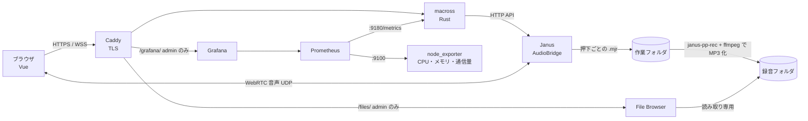

# Macross v0.1（α版）

要件定義書のフェーズ1（1チャンネルでの音声伝送）＋最小限の管理機能。

## できること

| 機能 | 内容 |
|---|---|
| PTT 通話 | ボタン（PC はスペースキーも可）を押している間だけ送信。1チャンネル |
| MCU 配信 | Janus AudioBridge がサーバ側でミックス。自分の声は自分に返らない |
| 発言枠 | 同時に話せる人数を管理画面で変更（埋まっていると押しても送信されない） |
| 録音 | 押下1回ごとに MP3 を保存 `<録音先>/ch1/yyyy-mm-dd_HHMM_<ID>.mp3`、`index.csv` に開始・終了時刻を記録。90日で自動削除 |
| 録音ブラウザ | 録音先を [File Browser](https://filebrowser.org/) で公開。`https://<ドメイン>/files/`（画面上部の「録音」）から再生・ダウンロード。admin のみ |
| ログイン | システムが発行した ID ＋ パスワード。初回ログイン時にパスワード変更を強制 |
| 管理画面（admin） | ID 発行（名前・ふりがな・メール）、admin 権限の付与・解除、無効化、発言枠の設定 |
| 接続上限 | `limits.max_connections`（既定 30） |
| 監視 | Grafana（`https://<ドメイン>/grafana/`、画面上部の「監視」、admin のみ）。現在のユーザー数・発言中の人数・発言回数・通信量・CPU/メモリ/ディスク・録音数と使用量・ログイン成功/失敗 |

α版に**含まないもの**: 9チャンネル・LR受聴・TTS（フェーズ2）、2段階認証（フェーズ3）、文字起こし（フェーズ4）、Zabbix・Loki 連携。

## 構成



| フォルダ | 内容 |
|---|---|
| `server/` | Rust サーバ（認証・ID 管理・PTT 制御・Janus へのシグナリング中継・録音変換） |
| `web/` | Vue 3 フロントエンド |
| `janus/` | Janus コンテナ。起動時に `Macross.yaml` から Janus 設定を生成 |
| `caddy/` | HTTPS 終端（Let's Encrypt）。`/files/`・`/grafana/` は Macross の admin ログインを確認してから中継 |
| `monitoring/` | Prometheus の収集設定、Grafana のデータソースとダッシュボード（自動で読み込まれる） |
| `Macross.yaml` | サーバ設定（本番） |

## サーバへの導入（Rocky Linux 9）

```bash
# 1. Docker
sudo dnf config-manager --add-repo https://download.docker.com/linux/rhel/docker-ce.repo
sudo dnf install -y docker-ce docker-ce-cli containerd.io docker-compose-plugin
sudo systemctl enable --now docker

# 2. ファイアウォール（HTTPS と WebRTC 用 UDP）
sudo firewall-cmd --permanent --add-service=http --add-service=https
sudo firewall-cmd --permanent --add-port=20000-20200/udp
sudo firewall-cmd --reload

# 3. データフォルダ
sudo mkdir -p /srv/macross/data /srv/macross/recordings /srv/macross/work

# 4. 設定: Macross.yaml の janus.public_ip にサーバのグローバル IP を書く
sudo dnf install -y nano
nano Macross.yaml

# 5. 起動（HTTPS 込み）
MACROSS_DOMAIN=macross.build-maika.jp docker compose --profile tls up -d --build

# 6. 初期管理者の ID と初期パスワードを確認
docker compose logs server | grep 初期管理者
```

- DNS の A レコードをサーバのグローバル IP に向けておくこと（Caddy の証明書取得に必要）
- ルータ / クラウドのセキュリティグループでも TCP 80・443、UDP 20000-20200 を開放すること
- Cloudflare Tunnel を使う場合は Caddy を起動せず、Tunnel の転送先を `http://127.0.0.1:8080` にする（音声の UDP は Tunnel を通らないので、UDP ポートの開放は必要）。この場合 File Browser（127.0.0.1:8090）には外部から届かないため、録音は `ssh -L 8090:127.0.0.1:8090` などで閲覧する
- File Browser は録音フォルダを**読み取り専用**でマウントしている（録音の削除は保持期間による自動削除のみ）
- Prometheus（9090）・node_exporter（9100）・Grafana（3000）・メトリクス（9180）はすべて 127.0.0.1 のみで待ち受けるため、ファイアウォールで開ける必要はない。Prometheus のデータは 90 日保持
- SELinux が有効で `/srv/macross` に書き込めない場合は `sudo chcon -Rt container_file_t /srv/macross`

## Macross.yaml の主な項目

| キー | 意味 |
|---|---|
| `limits.max_connections` | 最大同時接続数 |
| `channel.max_speakers` | 発言枠の初期値（管理画面で変更すると `data/settings.json` が優先） |
| `audio.bitrate` | Opus ビットレート |
| `recording.dir` | MP3 保存先＝File Browser の公開フォルダ（docker-compose.yml の volumes と同じパスにする） |
| `recording.work_dir` | 変換前の作業ファイル置き場（File Browser には出さない） |
| `recording.retention_days` | 保持日数（既定 90） |
| `janus.public_ip` | サーバのグローバル IP |
| `janus.rtp_port_range` | WebRTC 用 UDP ポート範囲 |

## ローカル開発（Windows / Mac）

```bash
cd web && npm install && npm run build      # または npm run dev（5173 番、API は 8080 に中継）
cd ../server && cargo run -- --config ../Macross.dev.yaml
# http://127.0.0.1:8080 を開く。初期管理者はコンソールに表示される
```

Janus は Linux 用のため、ローカルではログイン・管理画面までは動くが、「接続する」は失敗する（音声サーバに接続できない旨のエラーになる）。

## 保存されるデータ

| ファイル | 内容 |
|---|---|
| `data/users.csv` | ID, 名前, ふりがな, メールアドレス, 初期パスワード（変更後は空欄になる） |
| `data/credentials.json` | パスワードハッシュ（Argon2）、admin、無効化フラグ |
| `data/settings.json` | 管理画面で変更した発言枠 |
| `recordings/ch1/*.mp3` | 押下ごとの録音 |
| `recordings/ch1/index.csv` | 録音ごとの開始・終了時刻、ID、名前、ファイル名 |

## 既知の制限（α版）

- ログインセッションはメモリ保持のため、サーバ再起動で全員ログアウトされる
- iPhone は Safari で利用。画面ロック中は音声が止まる場合がある
- Janus との結合部分（音声通話・録音の MP3 化）は実サーバ上での動作確認が必要
