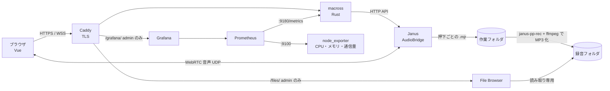

# Macross v0.1（α版）

要件定義書のフェーズ1（1チャンネルでの音声伝送）＋最小限の管理機能。

## できること

| 機能 | 内容 |
|---|---|
| PTT 通話 | ボタン（PC はスペースキーも可）を押している間だけ送信。1チャンネル |
| MCU 配信 | Janus AudioBridge がサーバ側でミックス。自分の声は自分に返らない |
| 発言枠 | 同時に話せる人数を管理画面で変更（埋まっていると押しても送信されない） |
| 録音 | 押下1回ごとに MP3 を保存 `<録音先>/ch1/yyyy-mm-dd_HHMM_<ID>.mp3`、`index.csv` に開始・終了時刻を記録。90日で自動削除 |
| 録音ブラウザ | 録音先を [File Browser](https://filebrowser.org/) で公開。`https://<ドメイン>/files/`（画面上部の「録音」）から再生・ダウンロード。admin のみ |
| ログイン | システムが発行した ID ＋ パスワード。初回ログイン時にパスワード変更を強制 |
| 管理画面（admin） | ID 発行（名前・ふりがな・メール）、admin 権限の付与・解除、無効化、発言枠の設定 |
| 接続上限 | `limits.max_connections`（既定 30） |
| 監視 | Grafana（`https://<ドメイン>/grafana/`、画面上部の「監視」、admin のみ）。現在のユーザー数・発言中の人数・発言回数・通信量・CPU/メモリ/ディスク・録音数と使用量・ログイン成功/失敗 |

α版に**含まないもの**: 9チャンネル・LR受聴・TTS（フェーズ2）、2段階認証（フェーズ3）、文字起こし（フェーズ4）、Zabbix・Loki 連携。

## 構成



| フォルダ | 内容 |
|---|---|
| `server/` | Rust サーバ（認証・ID 管理・PTT 制御・Janus へのシグナリング中継・録音変換） |
| `web/` | Vue 3 フロントエンド |
| `config/` | 起動時に `Macross.yaml` から Janus・Caddy・Grafana の設定を生成するコンテナ |
| `janus/` | Janus コンテナ |
| （Caddy） | HTTPS 終端（Let's Encrypt）。`/files/`・`/grafana/` は Macross の admin ログインを確認してから中継。設定は `config/` が生成 |
| `monitoring/` | Prometheus の収集設定、Grafana のデータソースとダッシュボード（自動で読み込まれる） |
| `Macross.yaml` | サーバ設定（本番） |

## サーバへの導入（Rocky Linux 9）

以下、ドメインを `macross.build-maika.jp` とした例。別のドメインを使う場合は読み替えること。

### 1. サーバのグローバル IP を調べる

```bash
curl -4 -s https://ifconfig.me ; echo
```

表示された IP（例 `203.0.113.10`）を以降の手順で使う。

> 自宅回線などで IP が変わる場合は、固定 IP の契約か DDNS が必要。IP が変わると DNS と `Macross.yaml` の `janus.public_ip` の両方を直すことになる。

### 2. ドメインの設定（DNS）

ドメインの管理画面で、サブドメインをサーバの IP に向ける **A レコード** を追加する。

**Cloudflare でドメインを管理している場合**

1. Cloudflare ダッシュボード → 対象ドメイン（`build-maika.jp`）→ **DNS** → **Records** → **Add record**
2. 次のように入力して **Save**

   | 項目 | 値 |
   |---|---|
   | Type | `A` |
   | Name | `macross` |
   | IPv4 address | 手順1の IP |
   | Proxy status | **DNS only**（灰色の雲。オレンジの雲＝Proxied にしない） |
   | TTL | Auto |

   Proxied にすると HTTPS の証明書を Caddy が取得できなかったり、Cloudflare の SSL 設定次第でリダイレクトが繰り返されたりするため、DNS only にする。

**その他のレジストラ（お名前.com など）の場合**

DNS レコード設定画面で、ホスト名 `macross`、種別 `A`、値に手順1の IP を登録する。

**反映の確認**（数分〜1時間ほどかかることがある）

```bash
sudo dnf install -y bind-utils
dig +short macross.build-maika.jp
# → 手順1の IP が表示されれば OK
```

### 3. ポートを開ける

自宅や社内のルータ配下にサーバがある場合は、ルータで次のポートをサーバへ転送（ポートフォワード）する。クラウドの場合はセキュリティグループで許可する。

| ポート | 用途 |
|---|---|
| TCP 80 | 証明書の取得（Let's Encrypt）、HTTPS へのリダイレクト |
| TCP 443 | Web 画面・WebSocket |
| UDP 20000-20200 | 音声（WebRTC） |

サーバ自身のファイアウォール:

```bash
sudo firewall-cmd --permanent --add-service=http --add-service=https
sudo firewall-cmd --permanent --add-port=20000-20200/udp
sudo firewall-cmd --reload
```

### 4. Docker とフォルダの準備

```bash
sudo dnf config-manager --add-repo https://download.docker.com/linux/rhel/docker-ce.repo
sudo dnf install -y docker-ce docker-ce-cli containerd.io docker-compose-plugin nano
sudo systemctl enable --now docker

sudo mkdir -p /srv/macross/data /srv/macross/recordings /srv/macross/work
```

SELinux が有効で `/srv/macross` に書き込めない場合は `sudo chcon -Rt container_file_t /srv/macross`。

### 5. Macross.yaml の設定（ドメイン・IP）

設定は `Macross.yaml` だけで行う。起動時に `config` コンテナがこのファイルから Janus・Caddy（HTTPS）・Grafana の設定を自動生成する。

```bash
nano Macross.yaml
```

最低限、次の2か所を書き換える。

```yaml
server:
  domain: "macross.build-maika.jp"   # 手順2で DNS に登録したドメイン
  https: "caddy"                     # Caddy が HTTPS 証明書を自動取得（Cloudflare Tunnel を使う場合は tunnel）
  acme_email: "you@example.com"      # 任意。証明書の期限切れ通知の宛先

janus:
  public_ip: "203.0.113.10"          # 手順1の IP（音声はドメインではなくこの IP に直接届く）
```

`server.domain` が空だと起動時に `config` コンテナがエラーで止まり、ほかのコンテナも起動しない（`sudo docker compose logs config` で理由を確認できる）。

### 6. 起動

```bash
sudo docker compose up -d --build
```

初回はビルドに数分かかる。生成された設定は次で確認できる。

```bash
sudo docker compose logs config
# → 設定を生成しました: https://macross.build-maika.jp / Janus public_ip=203.0.113.10, UDP 20000-20200
```

### 7. HTTPS 証明書の確認

```bash
sudo docker compose logs caddy | grep -i "certificate obtained"
```

`certificate obtained successfully` が出ていれば、`https://macross.build-maika.jp` で開ける。

### 8. 初期管理者でログイン

```bash
sudo docker compose logs server | grep 初期管理者
```

表示された ID（`0001`）と初期パスワードでログインし、新しいパスワードを設定する。

### ドメインや設定を変更するとき

1. （ドメインを変える場合）新しいドメインで手順2（DNS）を行う
2. `Macross.yaml` を書き換える
3. 設定を作り直して再起動する（新しいドメインの証明書は自動で取得される）

   ```bash
   sudo docker compose down && sudo docker compose up -d
   ```

### うまくいかないとき

| 症状 | 確認すること |
|---|---|
| どのコンテナも起動しない | `sudo docker compose logs config`（`Macross.yaml` の書き間違い・`server.domain` 未設定） |
| `https://` で開けない、証明書エラー | `dig` で IP が正しいか、TCP 80・443 が外から届くか、Cloudflare が DNS only か。`sudo docker compose logs caddy` |
| ログインできるが「接続する」で失敗する | `sudo docker compose logs janus`、`sudo docker compose logs server` |
| 接続済みになるが音声が聞こえない | `janus.public_ip` が正しいか、UDP 20000-20200 がルータ・ファイアウォールで開いているか |
| 録音が保存されない | `sudo docker compose logs server \| grep 録音` |

### Cloudflare Tunnel を使う場合（任意）

ポート 80・443 を開けられない環境向け。HTTPS は Cloudflare が受け持ち、Caddy は `127.0.0.1:8081` で Tunnel からの通信だけを受ける。

1. `Macross.yaml` を `https: "tunnel"` にして起動する（手順2の A レコード登録と TCP 80・443 の開放は不要）

   ```yaml
   server:
     domain: "macross.build-maika.jp"
     https: "tunnel"
   ```

2. サーバに cloudflared を入れてトンネルを作る

   ```bash
   cloudflared tunnel login
   cloudflared tunnel create macross
   cloudflared tunnel route dns macross macross.build-maika.jp   # DNS は自動で CNAME が作られる（手順2の A レコードは不要）
   ```

3. `~/.cloudflared/config.yml` で転送先を Caddy（`127.0.0.1:8081`）に向けて、サービスとして起動する

   ```yaml
   tunnel: macross
   credentials-file: /root/.cloudflared/<トンネルID>.json
   ingress:
     - hostname: macross.build-maika.jp
       service: http://127.0.0.1:8081
     - service: http_status:404
   ```

   ```bash
   sudo cloudflared service install
   ```

- 音声の UDP は Tunnel を通らないため、**UDP 20000-20200 の開放と `janus.public_ip` の設定は必要**
- Caddy を経由するので、録音ブラウザ（`/files/`）と Grafana（`/grafana/`）も Tunnel 経由でそのまま使える

### 補足

- File Browser は録音フォルダを**読み取り専用**でマウントしている（録音の削除は保持期間による自動削除のみ）
- Prometheus（9090）・node_exporter（9100）・Grafana（3000）・メトリクス（9180）はすべて 127.0.0.1 のみで待ち受けるため、ファイアウォールで開ける必要はない。Prometheus のデータは 90 日保持

## Macross.yaml の主な項目

| キー | 意味 |
|---|---|
| `server.domain` | 公開するドメイン（HTTPS 証明書・Grafana の URL に使う） |
| `server.https` | `caddy`（Let's Encrypt で HTTPS）／`tunnel`（Cloudflare Tunnel） |
| `server.acme_email` | 証明書の通知先メールアドレス（任意） |
| `limits.max_connections` | 最大同時接続数 |
| `channel.max_speakers` | 発言枠の初期値（管理画面で変更すると `data/settings.json` が優先） |
| `audio.bitrate` | Opus ビットレート |
| `recording.dir` | MP3 保存先＝File Browser の公開フォルダ（docker-compose.yml の volumes と同じパスにする） |
| `recording.work_dir` | 変換前の作業ファイル置き場（File Browser には出さない） |
| `recording.retention_days` | 保持日数（既定 90） |
| `janus.public_ip` | サーバのグローバル IP |
| `janus.rtp_port_range` | WebRTC 用 UDP ポート範囲 |

## ローカル開発（Windows / Mac）

```bash
cd web && npm install && npm run build      # または npm run dev（5173 番、API は 8080 に中継）
cd ../server && cargo run -- --config ../Macross.dev.yaml
# http://127.0.0.1:8080 を開く。初期管理者はコンソールに表示される
```

Janus は Linux 用のため、ローカルではログイン・管理画面までは動くが、「接続する」は失敗する（音声サーバに接続できない旨のエラーになる）。

## 保存されるデータ

| ファイル | 内容 |
|---|---|
| `data/users.csv` | ID, 名前, ふりがな, メールアドレス, 初期パスワード（変更後は空欄になる） |
| `data/credentials.json` | パスワードハッシュ（Argon2）、admin、無効化フラグ |
| `data/settings.json` | 管理画面で変更した発言枠 |
| `recordings/ch1/*.mp3` | 押下ごとの録音 |
| `recordings/ch1/index.csv` | 録音ごとの開始・終了時刻、ID、名前、ファイル名 |

## 既知の制限（α版）

- ログインセッションはメモリ保持のため、サーバ再起動で全員ログアウトされる
- iPhone は Safari で利用。画面ロック中は音声が止まる場合がある
- Janus との結合部分（音声通話・録音の MP3 化）は実サーバ上での動作確認が必要
