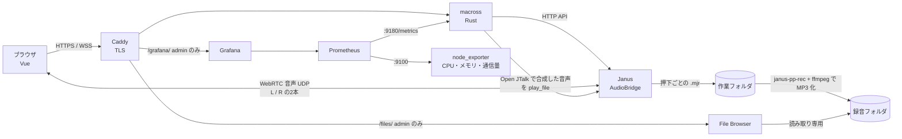

# Macross v0.6

要件定義書のフェーズ2（9チャンネル・LR受聴・TTS）に、運用で要望のあった機能を足した版。v0.4 の機能はすべて含む。

## v0.6 で変わったこと

| 項目 | 内容 |
|---|---|
| スマホ用の画面 | 幅 760px 以下ではメニューを画面下のタブバーにし、無線画面は PTT ボタンを親指で押せる大きさに（LR受聴は左右の PTT を横並び）。読み上げ欄は折りたたみ。ホーム画面に追加するとアプリのように全画面で開く（`manifest.webmanifest`） |
| 管理画面は PC 推奨 | スマホ・タブレットで管理・地図・録音を開くと「PC での操作を推奨」と表示（閉じると次からは出ない。操作はそのままできる） |
| 地図: 密集箇所のクローズアップ | 点が集まっているところは件数入りの丸にまとめる。丸を押すと、ばらけるところまで寄る。「密集地点へ」ボタンで点が最も多い場所へ移動。引いた表示では名前ラベルを隠す |
| 地図: 点を押すと情報 | 記録の点・人のピンを押すと **時間・ユーザー・場所（住所＋緯度経度・誤差）** を表示。住所は国土地理院の逆ジオコーダで取得（サーバ経由・送るのは座標だけ。`location.reverse_geocode`） |
| 位置の記録（GNSS ログ CSV） | 位置を `data/gnss/日付.csv` に記録し、地図の履歴はこの CSV から表示（サーバを再起動しても消えない）。1 人あたり 30 秒ごと、または 20m 以上動いたときに 1 行、PTT・読み上げは毎回。地図で期間（1時間・24時間・7日）を選べ、日付ごとの CSV をダウンロードできる。90 日で自動削除 |
| ロゴ | 透過素材に変更（`ロゴ.ai` から作成）。ダークテーマでは線の色を明るくしたロゴに切り替える |
| ログインの維持 | ログインは 30 日保持（`server.session_days`。使っている間は自動で延長）。セッションを `data/sessions.json` に保存するので、サーバを再起動してもログインしたまま |
| 無線の受信の維持 | 接続が切れたら自動で再接続（1→2→5→10→30 秒）。画面に戻ったとき・ネットに復帰したときはすぐ再接続。25 秒ごとに通信を確認し、応答がなければつなぎ直す。音声だけ切れたときは同じチャンネルに入り直す。地図・管理などへ移っても無線はつないだまま。ロック画面に「受信中: チャンネル名」を表示（Media Session）。ページを開き直したときは「タップして再接続」を表示 |
| 初期の ID | 新しく立ち上げたときに作る ID は 0000 だけ（他の ID は管理画面で発行する） |
| 既定のメール送信（さくら） | `Macross.yaml` の `mail.smtp_*` に、さくらのメールボックス（`www2835.sakura.ne.jp:587`）を既定の送信サーバとして組み込んだ。`smtp_password` を書けば、管理画面で設定しなくても初期パスワードのメールを送れる。管理画面で別のサーバを設定した場合はそちらが優先 |
| メールアドレスの変更 | ユーザー一覧の「変更」で、名前・ふりがなと一緒にメールアドレスも変えられる（空欄にもできる。権限は名前の変更と同じ）。`superuser.email` も 0000 を作るときだけ使う |

> **画面を消したときの受信について**: Android の Chrome は、無線ページを開いたまま画面を消しても受信が続くことが多い（端末の省電力設定によっては止まる。止まっても画面を点けると自動で再接続する）。**iPhone はロック中にマイクと通信が止まる**ため、画面を点けたときの自動再接続までになる。確実に受信し続けたい場合は画面を点けたまま使う（接続中は画面が自動で消えないようにしている）。

## v0.5 で変わったこと

| 項目 | 内容 |
|---|---|
| 画面の改修 | ロゴ入りのヘッダー、テーマ（ホワイト・ダーク・グレー）、管理画面のタブ化、無線画面のレイアウト変更、スマホ表示の調整 |
| 録音画面 | 管理者メニューの「録音」で、チャンネルごとの録音を一覧・再生・ダウンロードできる（File Browser を読み取り専用で利用） |
| 名前の変更 | 管理画面のユーザー一覧で、名前の横の「変更」から名前・ふりがなを変えられる。接続中の人の表示にもすぐ反映される。一般ユーザと自分の名前は admin が、0000 と他の admin の名前はスーパーユーザーが変更できる。録音の `index.csv` には話した時点の名前が残る |
| 0000 の名前 | `Macross.yaml` の `superuser.name` / `furigana` は 0000 を作るときだけ使う（v0.4 は起動のたびに上書きしていた）。その後は管理画面で変更する |

## v0.4 で変わったこと

| 項目 | 内容 |
|---|---|
| 1 ID 1 ページ | 同じ ID で無線ページを開けるのは 1 つまで。別のタブ・別の端末で「接続する」と、前のページは「同じ ID で別のページから接続したため…」と表示して切断される（新しい方が優先。前のページが固まっていても締め出されない） |
| スーパーユーザー 0000 | ID `0000` は最上位ロールで固定（起動時に無ければ自動で作る）。無効化・admin の解除・管理画面からのパスワードリセットはできない。admin の付与・解除と、他の admin の無効化・パスワードリセットは 0000 だけができる。発言の割り込みは スーパーユーザー ＞ admin ＞ 一般 |
| チャンネルの利用権限 | 管理画面のユーザ一覧「使えるチャンネル」で、一般ユーザが聴ける・話せるチャンネルを制限できる。権限のないチャンネルは無線画面のプルダウンに出ない。変更は接続中の人にもすぐ反映される（聴いていたチャンネルの権限を外すと切り離される）。admin は常にすべて |
| 位置情報（GPS） | 無線ページで「接続する」と、ブラウザの位置情報を管理者に共有する（本人がブラウザで許可した場合のみ。画面に「📍 位置情報: 管理者に共有しています」と出る）。発信（PTT・読み上げ）した場所も記録し、録音の `index.csv` に緯度・経度を残す |
| 3D 地図 | 管理者メニューの「地図」（Vue + [MapLibre GL JS](https://maplibre.org/)）。接続中の人を柱とラベルで表示（発言中＝赤・受信中＝緑・2分以上更新なし＝灰）、発信した場所を点で表示。地理院タイル（標準地図・航空写真）・3D の建物・地形の切り替え、2D/3D の切り替え、一覧から選ぶとその人へ移動 |
| 無音の録音を自動削除 | PTT を押しただけで何も話していない録音は保存しない（`recording.delete_silent`。最大音量が `silence_threshold_db` 以下なら無音） |
| 「現在発言なし」 | 無線画面の発言者欄を常に表示し、誰も話していないときは「現在発言なし」。発言枠ぶんの高さを確保するので、誰かが話し始めても PTT ボタンの位置が動かない |
| メールの既定の送信元 | `unit_genesis-aerial@macross.build-maika.jp`（`mail.default_from`）。管理画面の送信元を空にするとこのアドレスを使う |
| 設定ファイルの場所 | サーバでは **`/srv/macross/Macross.yaml`**。データ（`data`）・録音（`recordings`）と同じ `/srv/macross` にまとめた。管理画面の「サーバ」欄にも場所を表示する。このフォルダの `Macross.yaml` はひな形 |

v0.4 の実機検証は「[v0.4 の実機検証](#v04-の実機検証2026-11-12)」、v0.3 で直した内容は「[実機検証の結果](#実機検証の結果2026-11-11)」を参照。

## できること

| 機能 | 内容 |
|---|---|
| PTT 通話 | ボタン（PC はスペースキー、LR受聴中の右は Enter キー）を押している間だけ送信 |
| MCU 配信 | Janus AudioBridge がサーバ側でミックス。自分の声は自分に返らない |
| 9チャンネル | 管理画面でチャンネルを作成・名前変更・削除（最大9）。利用者は画面のプルダウンでチャンネルを選ぶ |
| LR受聴 | 「LR受聴」をオンにすると2チャンネルに同時参加し、左耳・右耳で別々に聴ける。発言（PTT）も左右それぞれのボタンで送り分ける |
| 発言枠 | チャンネルごとに同時に話せる人数を管理画面で設定（埋まっていると押しても送信されない） |
| 割り込み | スーパーユーザー（0000）＞ admin ＞ 一般。発言枠が埋まっていても、自分より下のロールの人の発言（いちばん長く話している人）を止めて話せる。止められた人には通知が出て、そこまでの録音は保存される |
| 読み上げ（TTS） | 入力した文章を [Open JTalk](https://open-jtalk.sourceforge.net/) で音声にしてチャンネルに流す。声は ID ごとに重複しないよう自動で割り当て（音声モデル × 声の高さ × 話速 × 声質） |
| 録音 | 押下1回ごとに MP3 を保存 `<録音先>/<チャンネル名>/yyyy-mm-dd_HHMM_<ID>.mp3`。読み上げは `_tts.mp3`。`index.csv`（Excel で開ける）に開始・終了時刻、ID、種別、読み上げテキストを記録。90日で自動削除 |
| 録音ブラウザ | 録音先を [File Browser](https://filebrowser.org/) で公開。`https://<ドメイン>/files/`（画面上部の「録音」）から再生・ダウンロード。admin のみ |
| ログイン | システムが発行した ID ＋ パスワード。初回ログイン時にパスワード変更を強制 |
| 管理画面（admin） | チャンネルの作成・変更・削除と発言枠、ID 発行（名前・ふりがな・メール）、admin 権限の付与・解除、無効化、初期パスワードの閲覧（本人が変更するまで）、パスワードリセット（新しい初期パスワードを発行し、その人をログアウトさせる。自分自身は「パスワード変更」から） |
| メール送信 | ID 発行・CSV 一括登録・パスワードリセット時に、初期パスワードとログイン URL をメールで送る。SMTP サーバ・送信元アドレスは管理画面の「メール設定」で設定し、テスト送信できる |
| CSV 一括登録 | 管理画面からテンプレート（名前・ふりがな・メールアドレス）をダウンロードし、記入して読み込むと一括で ID を発行 |
| 接続上限 | `limits.max_connections`（既定 30） |
| 監視 | Grafana（`https://<ドメイン>/grafana/`、画面上部の「監視」、admin のみ）。現在のユーザー数・発言中の人数・発言回数・通信量・CPU/メモリ/ディスク・録音数と使用量・ログイン成功/失敗。v0.2 でチャンネル別の人数・発言回数・読み上げ回数を追加 |

まだ**含まないもの**: 2段階認証（フェーズ3）、文字起こし（フェーズ4）、負荷分散（フェーズ5）、デジタル簡易無線との接続（フェーズ7）。

## 構成



| フォルダ | 内容 |
|---|---|
| `server/` | Rust サーバ（認証・ID 管理・チャンネル管理・PTT 制御・Janus へのシグナリング中継・TTS・録音変換） |
| `web/` | Vue 3 フロントエンド |
| `config/` | 起動時に `Macross.yaml` から Janus・Caddy・Grafana の設定を生成するコンテナ |
| `janus/` | Janus コンテナ |
| （Caddy） | HTTPS 終端（Let's Encrypt）。`/files/`・`/grafana/` は Macross の admin ログインを確認してから中継。設定は `config/` が生成 |
| `tools/feature_test.py` | 実機テスト（割り込み発言・CSV 一括登録・メール設定） |
| `relay/` | ポート転送できない回線向けの VPS 中継（WireGuard）セットアップ |
| `tools/e2e_test.py` | 実機 E2E テスト（2 人分のブラウザを模擬し、実際の音声で通話・録音・LR・読み上げを確認） |
| `monitoring/` | Prometheus の収集設定、Grafana のデータソースとダッシュボード（自動で読み込まれる） |
| `Macross.yaml` | サーバ設定のひな形（サーバでは `/srv/macross/Macross.yaml` にコピーして編集する） |

## サーバへの導入（Rocky Linux 9）

以下、ドメインを `macross.build-maika.jp` とした例。別のドメインを使う場合は読み替えること。

### 1. サーバのグローバル IP を調べる

```bash
curl -4 -s https://ifconfig.me ; echo
```

表示された IP（例 `203.0.113.10`）を以降の手順で使う。

> 自宅回線などで IP が変わる場合は、固定 IP の契約か DDNS が必要。IP が変わると DNS と `Macross.yaml` の `janus.public_ip` の両方を直すことになる。

### 2. ドメインの設定（DNS）

ドメインの管理画面で、サブドメインをサーバの IP に向ける **A レコード** を追加する。

**Cloudflare でドメインを管理している場合**

1. Cloudflare ダッシュボード → 対象ドメイン（`build-maika.jp`）→ **DNS** → **Records** → **Add record**
2. 次のように入力して **Save**

   | 項目 | 値 |
   |---|---|
   | Type | `A` |
   | Name | `macross` |
   | IPv4 address | 手順1の IP |
   | Proxy status | **DNS only**（灰色の雲。オレンジの雲＝Proxied にしない） |
   | TTL | Auto |

   Proxied にすると HTTPS の証明書を Caddy が取得できなかったり、Cloudflare の SSL 設定次第でリダイレクトが繰り返されたりするため、DNS only にする。

**その他のレジストラ（お名前.com など）の場合**

DNS レコード設定画面で、ホスト名 `macross`、種別 `A`、値に手順1の IP を登録する。

**反映の確認**（数分〜1時間ほどかかることがある）

```bash
sudo dnf install -y bind-utils
dig +short macross.build-maika.jp
# → 手順1の IP が表示されれば OK
```

### 3. ポートを開ける

自宅や社内のルータ配下にサーバがある場合は、ルータで次のポートをサーバへ転送（ポートフォワード）する。クラウドの場合はセキュリティグループで許可する。

| ポート | 用途 |
|---|---|
| TCP 80 | 証明書の取得（Let's Encrypt）、HTTPS へのリダイレクト |
| TCP 443 | Web 画面・WebSocket |
| UDP 20000-20200 | 音声（WebRTC） |

サーバ自身のファイアウォール:

```bash
sudo firewall-cmd --permanent --add-service=http --add-service=https
sudo firewall-cmd --permanent --add-port=20000-20200/udp
sudo firewall-cmd --reload
```

### 4. Docker とフォルダの準備

```bash
sudo dnf config-manager --add-repo https://download.docker.com/linux/rhel/docker-ce.repo
sudo dnf install -y docker-ce docker-ce-cli containerd.io docker-compose-plugin nano
sudo systemctl enable --now docker

sudo mkdir -p /srv/macross/data /srv/macross/recordings /srv/macross/work /srv/macross/voices
sudo install -m 600 Macross.yaml /srv/macross/Macross.yaml   # 設定ファイル（ひな形をコピー）
```

> `/srv/macross/Macross.yaml` を作らずに起動すると、Docker が同じ名前の**フォルダ**を作ってしまい起動に失敗する。そうなったら `sudo rmdir /srv/macross/Macross.yaml` してからコピーし直す。

SELinux が有効（RHEL 系の既定）なら、コンテナから書き込めるようにラベルを付ける（AlmaLinux 9.8 で必要だった）。

```bash
sudo chcon -Rt container_file_t /srv/macross
```

### 5. Macross.yaml の設定（ドメイン・IP）

設定は **`/srv/macross/Macross.yaml`** だけで行う。起動時に `config` コンテナがこのファイルから Janus・Caddy（HTTPS）・Grafana の設定を自動生成する。

```bash
sudo nano /srv/macross/Macross.yaml
```

最低限、次の2か所を書き換える。

```yaml
server:
  domain: "macross.build-maika.jp"   # 手順2で DNS に登録したドメイン
  https: "caddy"                     # Caddy が HTTPS 証明書を自動取得（Cloudflare Tunnel を使う場合は tunnel）
  acme_email: "you@example.com"      # 任意。証明書の期限切れ通知の宛先

janus:
  public_ip: "203.0.113.10"          # 手順1の IP（音声はドメインではなくこの IP に直接届く）
```

`server.domain` が空だと起動時に `config` コンテナがエラーで止まり、ほかのコンテナも起動しない（`sudo docker compose logs config` で理由を確認できる）。

### 6. 起動

```bash
sudo docker compose up -d --build
```

初回はビルドに数分かかる。生成された設定は次で確認できる。

```bash
sudo docker compose logs config
# → 設定を生成しました: https://macross.build-maika.jp / Janus public_ip=203.0.113.10, UDP 20000-20200
```

### 7. HTTPS 証明書の確認

```bash
sudo docker compose logs caddy | grep -i "certificate obtained"
```

`certificate obtained successfully` が出ていれば、`https://macross.build-maika.jp` で開ける。

### 8. スーパーユーザー（0000）でログイン

```bash
sudo docker compose logs server | grep スーパーユーザー
```

表示された ID `0000` と初期パスワードでログインし、新しいパスワードを設定する。表示名は管理画面のユーザー一覧で名前の横の「変更」から変えられる。

### 0000 のパスワードを忘れたとき

管理画面からはリセットできない（ほかの admin に最上位の権限を奪われないように）。サーバで次を実行すると新しい初期パスワードが表示される。

```bash
cd /opt/macross
sudo docker compose stop server
sudo docker compose run --rm --no-deps server macross --config /etc/macross/Macross.yaml reset-superuser
sudo docker compose start server
```

### ドメインや設定を変更するとき

1. （ドメインを変える場合）新しいドメインで手順2（DNS）を行う
2. `/srv/macross/Macross.yaml` を書き換える
3. 設定を作り直して再起動する（新しいドメインの証明書は自動で取得される）

   ```bash
   sudo docker compose down && sudo docker compose up -d
   ```

### うまくいかないとき

| 症状 | 確認すること |
|---|---|
| どのコンテナも起動しない | `sudo docker compose logs config`（`Macross.yaml` の書き間違い・`server.domain` 未設定） |
| `https://` で開けない、証明書エラー | `dig` で IP が正しいか、TCP 80・443 が外から届くか、Cloudflare が DNS only か。`sudo docker compose logs caddy` |
| ログインできるが「接続する」で失敗する | `sudo docker compose logs janus`、`sudo docker compose logs server` |
| 接続済みになるが音声が聞こえない | `janus.public_ip` が正しいか、UDP 20000-20200 がルータ・ファイアウォールで開いているか |
| 録音が保存されない | `sudo docker compose logs server \| grep 録音` |
| 読み上げが流れない | `sudo docker compose logs server \| grep -i "TTS\|読み上げ"`（音声モデルが見つからない、open_jtalk・ffmpeg のエラー、Janus の play_file エラー） |
| 管理画面で消したチャンネルの人が戻らない | 削除されたチャンネルの参加者は自動で切り離される。プルダウンで別のチャンネルを選び直す |

### Cloudflare Tunnel を使う場合（任意）

ポート 80・443 を開けられない環境向け。HTTPS は Cloudflare が受け持ち、Caddy は `127.0.0.1:8081` で Tunnel からの通信だけを受ける。

1. `Macross.yaml` を `https: "tunnel"` にして起動する（手順2の A レコード登録と TCP 80・443 の開放は不要）

   ```yaml
   server:
     domain: "macross.build-maika.jp"
     https: "tunnel"
   ```

2. サーバに cloudflared を入れてトンネルを作る

   ```bash
   cloudflared tunnel login
   cloudflared tunnel create macross
   cloudflared tunnel route dns macross macross.build-maika.jp   # DNS は自動で CNAME が作られる（手順2の A レコードは不要）
   ```

3. `~/.cloudflared/config.yml` で転送先を Caddy（`127.0.0.1:8081`）に向けて、サービスとして起動する

   ```yaml
   tunnel: macross
   credentials-file: /root/.cloudflared/<トンネルID>.json
   ingress:
     - hostname: macross.build-maika.jp
       service: http://127.0.0.1:8081
     - service: http_status:404
   ```

   ```bash
   sudo cloudflared service install
   ```

- 音声の UDP は Tunnel を通らないため、**UDP 20000-20200 の開放と `janus.public_ip` の設定は必要**
- Caddy を経由するので、録音ブラウザ（`/files/`）と Grafana（`/grafana/`）も Tunnel 経由でそのまま使える

### ポート転送できない回線で公開する（VPS で中継）

多段 NAT やポート転送できない回線の場合は、グローバル IP を持つ VPS を1台用意し、WireGuard トンネルで中継する。ルータの設定は不要で、音声の UDP も通る。

```
利用者 ──HTTPS / UDP──> VPS（グローバル IP）══ WireGuard ══> Macross サーバ（LAN 内）
```

1. Macross サーバで鍵を作る: `sudo sh relay/server-setup.sh key`（公開鍵が表示される）
2. VPS に `relay/vps-setup.sh` をコピーし、`sudo sh vps-setup.sh <1 の公開鍵>`（VPS の公開鍵が表示される）
3. Macross サーバでトンネルを張る: `sudo sh relay/server-setup.sh up <VPS の IP> <2 の公開鍵>`
4. `Macross.yaml` の `janus.public_ip` を VPS の IP にし、DNS の A レコードを VPS の IP **だけ**にする
5. `sudo docker compose down && sudo docker compose up -d`

- VPS 側で開けるポート: UDP 31820（WireGuard。さくらの VPS のパケットフィルタは 32767 までしか指定できないため既定を 31820 にしている）、TCP 80・443、UDP 20000-20200。さくらの VPS などコントロールパネルにパケットフィルタがある場合はそちらでも開ける
- Macross サーバから見ると利用者の IP はすべて 10.99.0.1 になる

### LAN 内だけで試す場合（`https: "internal"`）

グローバル公開の前に社内・自宅 LAN で試すときの設定。ドメインが無くても IP で動く。ブラウザのマイクは HTTPS でしか使えないため、Caddy が自己署名の証明書で HTTPS にする。

```yaml
server:
  domain: "10.40.0.13"      # サーバの LAN の IP（または LAN 内で引けるホスト名）
  https: "internal"
janus:
  public_ip: "10.40.0.13"   # LAN の IP
```

- 初回アクセス時にブラウザが証明書の警告を出すので、「詳細設定 → 10.40.0.13 にアクセスする（安全ではありません）」で進む
- iPhone・Android で警告なしに使う（WebSocket が警告で切られるのを防ぐ）には、Caddy のルート証明書を端末にインストールする

  ```bash
  sudo docker compose cp caddy:/data/caddy/pki/authorities/local/root.crt ./macross-root.crt
  # このファイルを端末に送り、iPhone は「設定 → 一般 → VPN とデバイス管理」でインストール後、
  # 「設定 → 一般 → 情報 → 証明書信頼設定」で信頼を有効にする
  ```

- 公開するときは `domain` を本番のドメイン、`https` を `caddy` に戻し、`public_ip` をグローバル IP にして `sudo docker compose down && sudo docker compose up -d`

### 補足

- File Browser は録音フォルダを**読み取り専用**でマウントしている（録音の削除は保持期間による自動削除のみ）
- Prometheus（9090）・node_exporter（9100）・Grafana（3000）・メトリクス（9180）はすべて 127.0.0.1 のみで待ち受けるため、ファイアウォールで開ける必要はない。Prometheus のデータは 90 日保持

## Macross.yaml の主な項目

| キー | 意味 |
|---|---|
| `server.domain` | 公開するドメイン（HTTPS 証明書・Grafana の URL に使う） |
| `server.https` | `caddy`（Let's Encrypt で HTTPS）／`tunnel`（Cloudflare Tunnel）／`internal`（LAN 検証用の自己署名証明書） |
| `server.acme_email` | 証明書の通知先メールアドレス（任意） |
| `server.lan_hosts` | `https: caddy` のとき、LAN から IP でも開けるようにする（例 `["10.40.0.13"]`。自己署名証明書） |
| `server.session_days` | ログインを保つ日数（既定 30。使っている間は自動で延長） |
| `limits.max_connections` | 最大同時接続数 |
| `channels.initial` | 初回起動時に作るチャンネル（名前・発言枠）。以降は管理画面で変更し `data/channels.json` に保存される |
| `channels.room_base` | チャンネル1の Janus ルーム番号（チャンネル n は room_base + n - 1） |
| `tts.enabled` | 読み上げの有効・無効 |
| `tts.voice_dir` | 追加の音声モデル（`*.htsvoice`）を置くフォルダ |
| `tts.max_chars` / `tts.cooldown_secs` | 1回の最大文字数／同じ人が続けて送れる間隔（秒） |
| `audio.bitrate` | Opus ビットレート |
| `recording.dir` | MP3 保存先＝File Browser の公開フォルダ（docker-compose.yml の volumes と同じパスにする） |
| `recording.work_dir` | 変換前の作業ファイル置き場（File Browser には出さない） |
| `recording.retention_days` | 保持日数（既定 90） |
| `recording.delete_silent` | 無音の録音を保存しない（既定 true） |
| `recording.silence_threshold_db` | 無音とみなす最大音量（既定 -45 dBFS。小声の録音が消える場合は -55 など小さくする） |
| `janus.public_ip` | サーバのグローバル IP |
| `janus.rtp_port_range` | WebRTC 用 UDP ポート範囲 |
| `superuser.name` / `furigana` / `email` | ID 0000 を作るときの表示名・ふりがな・メールアドレス（その後は管理画面の「変更」で変える） |
| `mail.default_from` | メールの既定の送信元（管理画面で送信元を空にしたとき）。さくらのメールボックスとして存在するアドレスにする |
| `mail.smtp_host` / `smtp_port` / `smtp_security` / `smtp_username` / `smtp_password` | 既定のメール送信サーバ（さくら `www2835.sakura.ne.jp`・587・STARTTLS）。`smtp_password` を書くと管理画面の設定なしで送信できる。`smtp_username` が空なら `default_from` を使う |
| `location.enabled` | 位置情報（GPS）を集めて「地図」に出す（既定 true） |
| `location.record_interval_secs` / `record_min_move_m` | 位置を記録する間隔（既定 30 秒）／これ以上動いたら間隔を待たずに記録（既定 20m） |
| `location.retention_days` | 位置の記録（`data/gnss/日付.csv`）を残す日数（既定 90。0 で削除しない） |
| `location.reverse_geocode` | 地図で点を押したときに住所を出す（既定 true。国土地理院の逆ジオコーダに座標だけを送る） |
| `location.glyphs` | 地図のまとまりの件数を描く文字（OpenFreeMap のフォント。空なら件数を出さない） |
| `location.base_tiles` / `photo_tiles` / `buildings_tilejson` / `terrain_tiles` | 地図の背景（地理院タイル）・航空写真・3D の建物（OpenFreeMap）・地形（AWS Terrain Tiles）。空にするとその層を出さない |

> 地図のタイルは管理者のブラウザが各サービスから直接読み込む（Macross のサーバは経由しない）。社内ネットワークなどで外部に出られない場合は地図の背景が表示されない（人の位置と一覧は表示される）。

## メールの設定（初期パスワードの送信）

管理画面の「メール設定」で SMTP サーバを設定し、「テスト送信」で届くことを確認する。

| 例 | SMTP サーバ | 暗号化 / ポート | ユーザ名・パスワード |
|---|---|---|---|
| Gmail | `smtp.gmail.com` | STARTTLS / 587 | Gmail アドレスと**アプリパスワード**（2 段階認証を有効にして発行） |
| Microsoft 365 | `smtp.office365.com` | STARTTLS / 587 | アカウントとパスワード（テナントで SMTP 認証の許可が必要） |
| さくらのメールボックス | `<初期ドメイン>.sakura.ne.jp` | STARTTLS / 587 | メールアドレスとパスワード |

- 自宅・社内回線は 25 番ポートからの直接送信がブロックされている（OP25B）ことが多いため、上のような送信サーバを経由する
- 送信元アドレスは、SMTP サーバが送信を許可しているアドレスにする（違うと迷惑メール扱い・拒否される）。空にすると既定の `unit_genesis-aerial@macross.build-maika.jp`（`mail.default_from`）になるので、このアドレスで送れる SMTP サーバ（`macross.build-maika.jp` のメールサーバ等）を設定し、ドメインの SPF / DKIM も設定しておく
- メールが送れなくても ID の発行は完了する。結果画面に失敗理由が出るので、そのときは初期パスワードを直接伝える

## 読み上げの声を増やす（任意）

標準の音声モデルは Debian の `hts-voice-nitech-jp-atr503-m001`（男性1種）。これだけでも声の高さ・話速・声質の組み合わせで 330 通りの声を ID に割り当てる。
女性の声などを加えたい場合は、`.htsvoice` ファイルを `/srv/macross/voices/` に置いて再起動する（例: MMDAgent の「メイ」。ライセンスは各配布元で確認すること）。

```bash
sudo cp mei_normal.htsvoice /srv/macross/voices/
sudo docker compose restart server
sudo docker compose logs server | grep TTS
# → TTS: 音声モデル 2 個（660 通りの声）
```

> 音声モデルを増やす・減らすと、ID と声の対応が変わる。

## 実機検証の結果（2026-11-11）

AlmaLinux 9.8（4 コア / 7.5GB / 38GB、Docker 29.9 / Compose v5.7）に `https: "internal"` で構築し、`tools/e2e_test.py` で確認した。

| 項目 | 結果 |
|---|---|
| 全コンテナの起動（config → janus / caddy / grafana の順） | OK |
| HTTPS（自己署名）・WSS 経由のログインと接続 | OK |
| Janus AudioBridge への参加（L / R の 2 本） | OK |
| PTT で送信した音声が同じチャンネルの相手に届く（MCU ミックス） | OK（無音 0 → 発言中 4986） |
| 別チャンネル（R）には声が漏れない（LR の分離） | OK（0） |
| 発言枠 1 が埋まっているときの PTT 拒否 | OK |
| 押下ごとの録音 → MP3（`ch1/2026-11-11_1451_0001.mp3`、3.1 秒） | OK |
| 読み上げ（Open JTalk → play_file）が R のチャンネルに流れる | OK（3913） |
| 読み上げの MP3 保存と index.csv へのテキスト記録 | OK |
| 読み上げの連投制限 | OK |
| チャンネル削除で参加者が切り離される | OK |
| `/files/`・`/grafana/` は未ログインだと 401、admin なら表示 | OK |
| Prometheus の収集（Macross・node_exporter） | OK |
| VPS 中継（さくらの VPS / Rocky Linux 10）経由の HTTP 到達 | OK（Caddy が 308 を返す） |
| VPS 中継経由の音声（LAN の候補を除外し、経路が `→ 153.126.140.157:200xx` になることを確認） | OK（17/17） |
| DNS を VPS に向けたあとの Let's Encrypt 証明書取得（`https://macross.build-maika.jp`） | OK（Let's Encrypt、2027-02-09 まで。Caddy が自動更新） |
| 本番ドメイン経由の通しテスト（音声は VPS 経由） | OK（17/17） |

**v0.2 から直したもの**

| 問題 | 対応 |
|---|---|
| 読み上げが使えない（`TTS: 音声モデル (.htsvoice) が見つかりません`）。Dockerfile に open-jtalk のインストールが入っていなかった | Dockerfile に open-jtalk・辞書・音声モデルを追加。音声モデル `hts-voice-nitech-jp-atr503-m001` は Debian の **contrib** にあるため contrib を有効化 |
| ドメインもグローバル IP も無い LAN では HTTPS にできず、マイクが使えない | `server.https: "internal"`（自己署名証明書、IP 指定可）を追加 |
| Janus のログに `janus.logger.jsonlog.jcfg` が無いエラー | 使わないロガープラグインを無効化 |
| Janus のログに `Room 1001 already exists!` が出続ける | ルームの存在を確認（`exists`）してから作るように変更 |
| （要望）ID 発行時に初期パスワードをメールで送りたい | SMTP によるメール送信と管理画面の「メール設定」（テスト送信つき）を追加。ID 発行・CSV 一括登録・パスワードリセットで送信できる |
| （要望）一般ユーザが話していても管理者が話したい | admin は発言枠が埋まっていても一般ユーザの発言を止めて話せるようにした |
| （要望）CSV のテンプレートがほしい | 管理画面からテンプレートをダウンロードし、記入した CSV で一括登録できるようにした |
| （要望）初期パスワードを伝え忘れると確認できない、パスワードを忘れた人を救済できない | 管理画面のユーザ一覧で初期パスワードを「表示」できるようにし、「パスワードリセット」を追加。画面上部に「パスワード変更」へのリンクを追加 |

**未確認（実際の端末での確認が必要）**

- 実ブラウザ（PC の Chrome、iPhone の Safari、Android の Chrome）での画面操作、LR の左右の聞こえ方
- モバイル回線など外部からの実端末（iPhone の Safari・Android の Chrome）での接続

## v0.3 から移行する場合

1. バックアップ: `sudo cp -a /opt/macross /opt/macross-v0.3-backup && sudo tar czf ~/macross-data.tgz -C /srv/macross data`
2. 設定ファイルを移す: 今の `/opt/macross/Macross.yaml` の値（`domain`・`lan_hosts`・`public_ip` など）を、v0.4 の `Macross.yaml` に書き写して `/srv/macross/Macross.yaml` に置く（`sudo install -m 600 …`）
3. `/opt/macross` を v0.4 の中身に入れ替えて `sudo docker compose up -d --build`（フォルダ名は `macross` のまま。HTTPS 証明書などのボリュームを引き継ぐ）
4. ログに出る `0000` の初期パスワードでログインする。これまでの `0001` などはそのまま使える（admin のまま）
5. 録音の `index.csv` は列（緯度・経度）が増えたため、最初の録音のときに古いものが `index_old1.csv` に改名される

## v0.1 から移行する場合

- `Macross.yaml` の `channel:` は `channels:` に変わった（このフォルダの `Macross.yaml` を元に書き直す）
- `data/settings.json`（発言枠）は使われない。初回起動時に `channels.initial` からチャンネルが作られる
- 録音・ユーザ（`users.csv`・`credentials.json`）はそのまま使える
- `/srv/macross/voices` フォルダを作っておく（手順4）

## ローカル開発（Windows / Mac）

```bash
cd web && npm install && npm run build      # または npm run dev（5173 番、API は 8080 に中継）
cd ../server && cargo run -- --config ../Macross.dev.yaml
# http://127.0.0.1:8080 を開く。初期管理者はコンソールに表示される
```

Janus と Open JTalk は Linux 用のため、ローカルではログイン・管理画面（チャンネル管理を含む）までは動くが、「接続する」は失敗する（音声サーバに接続できない旨のエラーになる）。

## 保存されるデータ

| ファイル | 内容 |
|---|---|
| `data/users.csv` | ID, 名前, ふりがな, メールアドレス, 初期パスワード（変更後は空欄になる） |
| `data/credentials.json` | パスワードハッシュ（Argon2）、admin、無効化フラグ、使えるチャンネル |
| `data/channels.json` | チャンネル一覧（番号・名前・発言枠） |
| `data/mail.json` | メール設定（SMTP のパスワードを含むため root のみ読み書き可） |
| `data/sessions.json` | ログインセッション（トークンは SHA-256 のハッシュだけを保存。期限付き） |
| `data/gnss/YYYY-MM-DD.csv` | 位置の記録（GNSS ログ）: 日時, UNIXミリ秒, ID, 名前, 種別（位置 / PTT / TTS）, チャンネル, 緯度, 経度, 高度, 誤差 |
| `recordings/<チャンネル名>/*.mp3` | 押下ごとの録音、読み上げ（`_tts.mp3`） |
| `recordings/<チャンネル名>/index.csv` | 開始・終了時刻、チャンネル、ID、名前、種別（PTT / TTS）、ファイル名、読み上げテキスト、緯度・経度・位置の誤差 |

## v0.4 の実機検証（2026-11-12）

10.40.0.13（AlmaLinux 9.8）を v0.3 から v0.4 に更新し、`https://macross.build-maika.jp`（VPS 中継）で確認した。テストは aiortc で複数のブラウザを模擬して行い、画面は Edge（ヘッドレス・偽のマイクと位置情報）で撮って確認した。

| 確認したこと | 結果 |
|---|---|
| v0.3 からの更新（データ・HTTPS 証明書を引き継ぎ、0000 を自動作成、設定ファイルを `/srv/macross/Macross.yaml` へ） | OK |
| 権限の階層（admin は 0000 の無効化・リセット不可、admin の付与・解除は 0000 のみ、admin は他の admin をリセット不可） | 9/9 OK |
| メールの既定の送信元・管理画面の設定ファイルの場所 | OK |
| 使えるチャンネルの制限（見えない・参加できない・接続中に外すと切り離される） | 5/5 OK |
| 同じ ID で 2 つ目のページを開くと 1 つ目が切断される | OK |
| 位置情報（地図 API に出る・一般ユーザは使えない・発信履歴に残る・index.csv に緯度経度） | OK |
| 0000 が発言中の admin に割り込む | OK |
| 無音の録音（最大 -91 dB）は削除、声あり（440Hz）は保存 | OK |
| 「現在発言なし」表示で、発言の有無で PTT ボタンの位置が変わらない（498.97px → 498.97px） | OK |
| 3D 地図（地理院タイル・航空写真・建物・地形、発言中の人の赤い柱） | 画面で確認 |
| `reset-superuser`（0000 のパスワードリセット） | OK |

まだ確かめていないこと: 実際のスマートフォン（iPhone の Safari・Android の Chrome）での位置情報の精度と電池の減り方、実際のメール送信。

## 既知の制限

- 位置情報はブラウザが無線ページを開いている間だけ送られる（画面を消す・別のアプリに切り替えると止まることがある）。GPS の精度は端末と場所しだい（屋内では数十〜数百 m ずれる）
- 止まっている人の位置は、最後に届いた位置が 2 分以内のときだけ定期記録する（画面を消して GPS が止まった人を、同じ場所に居続けたように記録しないため）
- iPhone は Safari で利用。画面ロック中は音声・マイクが止まる（画面を点けると自動で再接続する）
- 住所の取得は国土地理院の逆ジオコーダ（無料・登録不要）を使う。サーバから外部に出られない環境では住所の代わりに緯度・経度だけを表示する
- Janus との結合部分（音声通話・LR受聴・録音の MP3 化・読み上げの play_file）は実サーバ上での動作確認が必要
- LR受聴の左右振り分けは Web Audio を使う。イヤホン推奨（スピーカーだとエコーキャンセルが効きにくい）
- 読み上げは発言枠を使わない（誰かが話していても重ねて流れる）。同じチャンネルの読み上げは順番に再生される
- チャンネル名を変えると、それ以降の録音は新しい名前のフォルダに保存される
